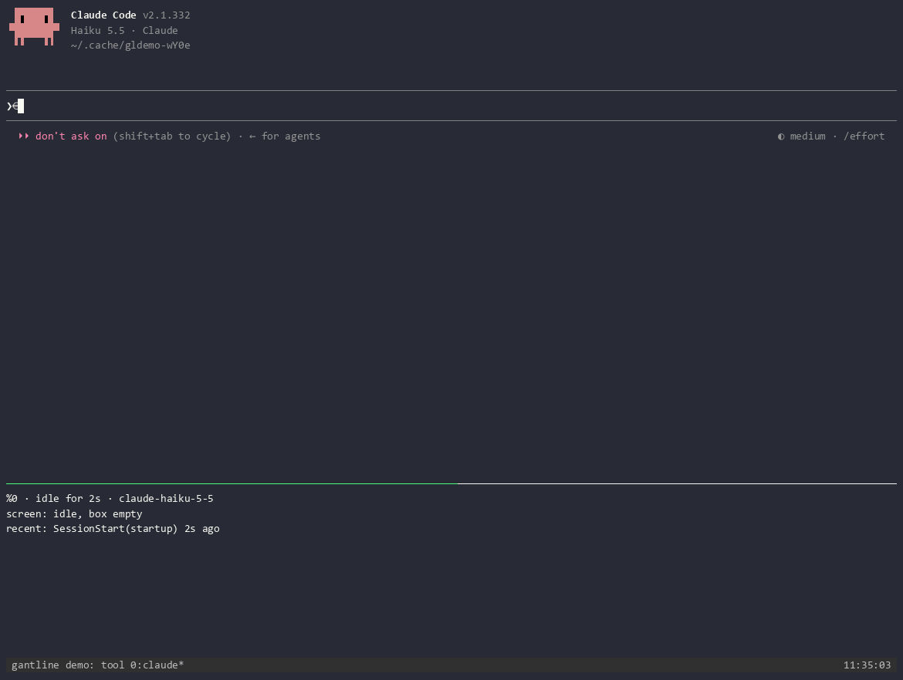
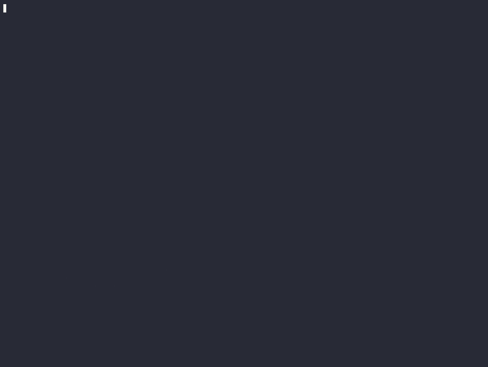

# gantline

gantline lets a [Claude Code](https://claude.com/claude-code) session inspect and control its own tmux pane. Through its own Bash tool, a session can read its screen and state, run built-in slash commands on itself (`/compact`, `/context`, `/clear`, `/mcp reconnect`), and restart itself in place.

A *pane* is the tmux pane the session runs in. A *turn* is one cycle of the session working: it starts when a prompt arrives and ends when the session stops and waits for input.

> **Warning: run gantline only in a sandbox.** gantline lets a model press keys in its own terminal. Anything that can make the session run a shell command can then use gantline. That includes a prompt injection in a file, a web page or a tool result. Through gantline, it can:
>
> - compact, clear or restart the session, or reconnect its MCP servers;
> - type into any other pane on the same tmux server with `gantline say`, including a plain shell, and including `!` commands and slash commands into another Claude Code session.
>
> gantline's guards are narrow. The queue runner never types over a person's draft, into an open dialog or during a turn, and nothing in gantline answers a permission prompt. `gantline say` has none of these guards, and nothing in gantline asks for confirmation. Run it in a container or VM you would trust with an unattended agent, with no credentials it doesn't need and nothing you can't afford to lose.

## What this makes possible

A session can't run `/compact`, `/clear`, `/context` or `/mcp` on itself, and it can't restart itself or change its own model. With gantline, a session can:

- **Keep working past its context window.** It reads its context use from `gantline status`, compacts itself with a keep list it writes, and resumes on its own with `--then`.
- **Switch model for one session.** `gantline model haiku` relaunches this session on another model without changing the default for other sessions the way `/model` does. The new model starts with a cold prompt cache and reads the whole conversation again at full price, so it pays off for a long stretch of work, rarely for a single task.
- **Build its own tooling and load it.** It can write a hook, an MCP server or a settings change, run `gantline restart`, and try the result in the same conversation.
- **Recover a failing MCP server.** It can queue `/mcp reconnect <server>` and retry the call.
- **Read what you see.** The `/context` panel, a permission prompt or an error drawn only in the terminal can all be read with `gantline screen`. That is also what lets a session run as its own end-to-end test, as gantline's tests do.
- **Work through a task list with a fresh context per task.** It can write a handoff file, `/clear` itself and pick up the next task from the file.

## What a session can do

| Task | Command |
|---|---|
| Read its activity, model, context use, input box, open dialog and queued items | `gantline status` |
| Read its screen, or the newest block of output | `gantline screen`, `gantline screen --region last` |
| Search its screen (matches come with row numbers) | `gantline screen --find '<regex>'` |
| Run a built-in slash command once the current turn ends | `gantline q /context` |
| Read what a queued command printed (`q` prints each item's ID: `q1`, `q2`, …) | `gantline q --show q1` |
| Compact itself and carry on unprompted | `gantline q --then 'carry on' '/compact keep: the plan'` |
| Clear its context | `gantline q /clear` |
| Reconnect an MCP server | `gantline q '/mcp reconnect <server>'` |
| Restart in place: same conversation and model, settings and MCP servers reloaded | `gantline restart` |
| Switch model for this session only | `gantline model sonnet` |
| List the tmux panes running Claude Code | `gantline panes` |
| Send a message to another pane, or to itself | `gantline say <pane> '<text>'`, `gantline say self '<text>'` |

A `<pane>` is a tmux pane ID such as `%3`; `gantline panes` lists them. Every `gantline q`, `restart` and `model` call takes its flags before the command text: `--then '<message>'`, `--timeout <duration>` (default `30m`) and `--pane <pane>`. Pass the command as one quoted argument with no newlines in it. `gantline model` takes any name `claude --model` accepts. Run `gantline -h` for every command, and `gantline <command> -h` for its flags. The `hook`, `statusline` and `launch` commands are internal: Claude Code and tmux run them.

## Demos

Both recordings are real Claude Code sessions on Haiku. The recorder changes only the home path, the user name and the subscription plan Claude Code's banner shows, and it shortens pauses to 2 seconds. The pane at the bottom runs `gantline status` every second, and the clock in the corner shows where a pause was shortened. Neither session shows a permission prompt: the demo project allows the shell, file edits and its own MCP servers, and refuses anything else without asking. It loads none of the recorder's own settings, instructions or MCP servers.

**A session builds itself a tool, then restarts to use it.** The prompt asks for a number rolled with an MCP tool the session builds, names `claude mcp add` and `gantline restart`, and tells it to finish without asking. The server code, the checks and the follow-up message are the session's own. Claude Code reads MCP servers only at startup, so after registering `dice.py` the session restarts itself. The demo's settings approve the project's MCP servers, so no approval prompt appears after the restart. The screen goes blank for a few seconds while gantline relaunches it on the same conversation. gantline then types the session's follow-up, and the status pane shows the new tool's call as a `PostToolUse(mcp__dice__…)` line. Claude Code collapses the call itself to `Called dice`; the number written to `done.txt` after it is that call's result, and any number the session mentions before the restart came from its own smoke test of the server. An injected prompt could load a malicious server the same way; see the warning above.

*The session writes an MCP server and restarts itself to load it, then calls the new tool.*



**A session's prompt bar works as a burn-rate thermometer.** A Stop hook ([`demo/thermo.sh`](demo/thermo.sh)) measures each turn's spend and queues `/color` with `gantline q` when the band changes. Each change lands just after its turn ends and shows in the transcript as a `/color` line, and the tmux bar gives the bands. The bar starts gray, Claude Code's default, until the first turn ends. Reading a 60 KB file is the warm turn, yellow. The question after it reads cyan again: every turn sends the whole conversation, but Claude Code caches it, and a cached reread costs a tenth of a fresh read. The prompt then tells the session to compact itself, and it runs `gantline q --then 'Say bye in two words.' '/compact …'`. The compaction is a model call too, and the statusline shows what it cost; it gets no color, because a `/color` queued during it would land after the goodbye. The goodbye after the compaction reads cyan, but only because Haiku is cheap. Compacting resets the cache, so the next turn writes it fresh, and on Sonnet that turn costs about as much as a session's first. What compaction pays for is context room. At this size it never reaches the orange or red bands.

*A Stop hook recolors the line above the prompt after each turn, by what the turn cost.*



The demo meters list-price dollars per minute, which is Claude Code's own estimate (`cost.total_cost_usd`), because a few cents of Haiku never moves a usage limit by a whole point. `thermo.sh` also has a mode that meters your pace against the 5-hour or weekly limit on a subscription, falling back to list-price dollars in extra usage or with an API key. That mode has run only on test numbers, not through a real day of use.

To record them again, install asciinema 2.x and agg, then run `demo/record.sh tool` or `demo/record.sh burn` in a sandbox, as with gantline itself: the session has the shell without prompts, and the tool demo has it write an MCP server and restart into it, which runs whatever command it registered. They need asciinema 2 and agg, and each run makes a few Haiku calls.

## Before you begin

You need:

- Linux or macOS, and tmux 3.0 or later. gantline drives panes with `tmux send-keys`. The real-session tests in this README ran on Linux. On macOS the unit tests pass in CI, but no real Claude Code session has been driven there yet.
- Go 1.26 or later (`go version`), with `$(go env GOPATH)/bin` on your `PATH`. An older Go 1.21+ downloads 1.26 by itself when `GOTOOLCHAIN` is left at its default.
- Claude Code 2.1.332 (`claude --version`), the only version gantline has been tested on. gantline reads screen strings from it. Others may work, but a new version can move the strings gantline acts on, and `gantline status` warns when the running version hasn't been checked. [`docs/claude-code-behavior.md`](docs/claude-code-behavior.md) lists the behavior gantline relies on.
- `jq`, which `gantline install` uses to validate the settings it writes.

## Install gantline

Run these steps inside the container or VM the warning above describes, as the user whose Claude Code sessions gantline will drive. They change that user's `~/.claude/settings.json`, which every one of that user's sessions reads.

1. Install the binary:

   ```sh
   go install github.com/justinstimatze/gantline/cmd/gantline@latest
   ```

2. Preview the change to `~/.claude/settings.json`:

   ```sh
   gantline install --dry-run
   ```

3. Apply it:

   ```sh
   gantline install
   ```

   This backs up the settings file to `~/.local/state/gantline/`, adds gantline's hooks, and wraps your statusline command so it still prints what it printed before. With no statusline configured, gantline adds its own, which prints nothing. The hooks run in every Claude Code session on the machine. Outside tmux they return at once and record nothing. Running `install` again changes nothing; `--settings <file>` edits a different settings file, such as a project's.

4. Tell your sessions that gantline exists. Without this step, a session has no way to know gantline is there. `install` offers to add these lines to `~/.claude/CLAUDE.md` between two marker comments, creating the file if it doesn't exist. It asks only when run in a terminal, and otherwise says it left the file alone; `--claude-md=yes` or `--claude-md=no` answers in advance, and `--claude-md-file` names another file. If the file already mentions `gantline q` outside the markers, `install` leaves it alone. To add the lines by hand instead, paste:

   ```markdown
   - To run a built-in slash command on yourself (`/compact`, `/context`, `/clear`, `/mcp reconnect <server>`),
     make `gantline q [--then '<message>'] '<command>'` your last tool call, then end your turn. The command
     is typed after your turn ends. Don't wait or poll for it. Its outcome arrives with your next prompt as a
     line like `gantline: q3 /compact … done`. `--then` types its message only when the outcome is `done`.
   - On `unconfirmed`, check `gantline status` and `gantline screen --region last` before you retry: the
     command may have run. On `expired` (the pane was never idle in time) or `rejected`, fix the cause before
     you queue it again. On `failed`, tell the user.
   - To restart yourself, run `gantline restart`; to switch your own model, run `gantline model <name>`.
     Make it your last tool call too. The restart ends your background tasks, watches and `/loop`, and a
     follow-up message asks you to re-arm them, so note what was running before you restart.
   - `gantline q` takes `/compact`, `/clear`, `/context`, `/mcp reconnect <server>` and `/color <color>`. It refuses
     other slash commands, since many open a dialog nothing would close; `--unchecked` queues one anyway. Never
     queue `/model` (it changes every new session's default); use `gantline model <name>`.
     Don't use `--pane` or `gantline say` on another pane unless the user asks.
   - To read your own state, run `gantline status`. To read your screen, run `gantline screen`
     (`--region last`, `--find '<regex>'`). To read what a queued command printed, run
     `gantline q --show <id>`, or add `--screen` for what the pane showed when it finished.
   ```

## Uninstall gantline

1. Run `gantline uninstall`. It removes gantline's hooks and restores the statusline command recorded at install.
2. It also removes the lines `install` added to `~/.claude/CLAUDE.md`. Remove any you pasted by hand.
3. Delete the binary (`rm "$(command -v gantline)"`) and, if you don't need the logs, `~/.local/state/gantline/`.

## How gantline works

Hooks append each Claude Code event to a journal for the pane: turn start and end, compaction, permission request, model switch and session start. The statusline wrapper records the model and context use. gantline's commands read that journal, and no daemon runs. For what hooks don't report (the input box, an open dialog, the mode line), gantline reads the screen with `tmux capture-pane`.

When you queue a command, `gantline q` appends it to the pane's queue and starts a *runner*. That background process exits once the queue is empty. It waits for the turn to end and the screen to go idle. It then types the command under a per-pane lock and checks the result from hook events and the transcript:

| Item | Done when |
|---|---|
| `/compact` | A manual compaction starts (the PreCompact hook) and finishes (PostCompact) |
| `/clear` | A new session starts with source `clear` (the SessionStart hook) |
| `/mcp` and other local commands | Their output appears in the transcript |
| `gantline restart`, `gantline model` | The relaunched process reports in with the same session ID, on the requested model |

The hooks are described in Claude Code's [hooks reference](https://code.claude.com/docs/en/hooks). The session sees each outcome with its next prompt, as a line like `gantline: q3 /compact … done`:

| Outcome | Meaning |
|---|---|
| `done` | Confirmed from hooks or the transcript. Only then does `--then` type its message |
| `rejected` | Claude Code ran it and refused it, such as an unknown model or MCP server |
| `unconfirmed` | Typed, but nothing confirmed what it did. It may have run, so check before retrying |
| `expired` | The pane was never idle before the item's timeout |
| `failed` | gantline couldn't type it, or a relaunched session didn't come back |

Queued items survive a restart, because the runner outlives the session's process.

The runner refuses to type when a person has a draft in the input box, a dialog is open, or a turn is running. It never presses a key to answer a dialog. `gantline say` has none of these guards: it types into a busy pane, and Claude Code queues the text.

To check the runner's deliveries, run `gantline audit` (last 24 hours; `--since` sets the window). It compares every keystroke delivery and relaunch against the journal, lists any that happened during a running turn, and exits 1 if there are any.

## Files and permissions

gantline keeps everything under `~/.local/state/gantline/` (or `$XDG_STATE_HOME/gantline/`), created with mode `0700`:

- `panes/<pane>/events.jsonl`: one line per hook event. It holds event names, times, session IDs, the transcript's path, and a few short fields such as the compaction trigger and a hook's error message. It never holds prompt text, replies, tool input or summaries.
- `panes/<pane>/status.json`: the latest model, context use and Claude Code version.
- `panes/<pane>/queue.jsonl`: queued commands, including their full text, any `--then` message, and up to 8 KiB of what the screen showed when each finished.
- `panes/<pane>/launch-*.json`: during a restart or model switch, the session's environment and command line, for the new process to read. It is deleted as soon as that process starts.
- `panes/<pane>/lastframe.json`: the text of the last screen `gantline screen --since` read.
- `say.jsonl`: one line per delivery, with sizes and timings but no message text.
- `q.log`: the queue runners' log, including the text of each queued command. Relaunch command lines appear with flag values removed.
- `settings.json.*.bak`: the settings backups `gantline install` makes.

Anyone who can reach your tmux socket can already type into your panes. gantline adds no network listener and no new way in.

Each hook is a short Go process. Run 300 times each with `hyperfine` on a loaded 8-core Linux machine, the `Stop` and `UserPromptSubmit` hooks averaged 3.9 ms and 4.5 ms of wall time. gantline makes no model calls. Commands it types into a session use that session's tokens as they would if you typed them.

## Test gantline against a real session

The tests in `e2e/` drive a real Claude Code session through the whole loop. It reads its own status and runs `/context` on itself, reading the panel back from the transcript and from the screen. It compacts itself with a keep list longer than 900 bytes, which tests that long slash commands are typed whole, and then resumes unprompted. It reconnects an MCP server and relaunches itself on another model. Each step is checked against the journal, the queue and files the session wrote, and `gantline audit` runs at the end.

These runs use the Claude Code login and settings of the machine they run on, so run them inside your sandbox. Each run is one short Haiku session plus a Sonnet relaunch.

```sh
# One run in a 200x50 pane, on Haiku:
go test -tags realclaude ./e2e -run TestSelfControl -count=1 -v

# Five runs in a row:
GANTLINE_E2E_RUNS=5 go test -tags realclaude ./e2e -run TestSelfControl -count=1 -v -timeout 30m

# A narrow 56x16 pane, with a background task that starts a turn mid-run:
GANTLINE_E2E_LIVE=1 go test -tags realclaude ./e2e -run TestSelfControl -count=1 -v
```

`TestScenarios` runs one fresh session per path the main run doesn't take, acting a person's part with tmux keys where one is needed:

| Scenario | What it checks |
|---|---|
| `clear` | A self-queued `/clear` starts a new session, and the follow-up reaches it |
| `restart` | `gantline restart` resumes the same conversation on the same model |
| `draft` | A person's draft in the box holds the item past the turn end, untouched, until the draft is gone |
| `permission` | An open permission prompt holds the item until a person answers it |
| `esc` | After an Esc interrupt, which fires no hook, the item waits for the next turn to end |
| `killed-runner` | A runner killed after typing `/compact` leaves it `unconfirmed`, and the next runner doesn't type it again |

```sh
# All of them:
go test -tags realclaude ./e2e -run TestScenarios -count=1 -v -timeout 40m

# Some of them:
GANTLINE_E2E_SCENARIOS=esc,draft go test -tags realclaude ./e2e -run TestScenarios -count=1 -v
```

A launch that never reaches the input box, or whose Claude Code exits during startup, is retried once, then reported as a host stall rather than a failure. [`docs/e2e-results.md`](docs/e2e-results.md) records the real runs and what they found.

The unit tests (`go test ./...`) need no Claude Code or login. It runs against a fake Claude Code screen in `say/testdata/fake-claude.sh`. A few tests check gantline's screen fingerprints against real captures, which aren't in this repository, and skip without them.

## Limits

- **Startup failures.** On a heavily loaded machine, some Claude Code launches never reach the input box. In one round of testing, about 1 in 6 of 30 drew nothing for 90 seconds and fired no hooks. In another, 3 of 15 exited during startup ([`docs/e2e-results.md`](docs/e2e-results.md)). The cause of both is unknown. If a restart or model switch hits a stall, the item is marked `failed`. The old process is already gone, and the pane holds the stalled new one, which gantline can't drive. Restart it by hand with `claude --resume <session ID>`; `q.log` names the session ID.
- **A restart replaces the pane's process.** When Claude Code ran under a shell in the pane, the shell is replaced too. The relaunched session runs under gantline, and when it exits the pane starts a new `$SHELL`, with the old shell's history and variables gone.
- **No Ctrl+Z after a relaunch.** A relaunched session has no job-control shell above it, so Ctrl+Z suspends Claude Code with nothing to bring it back, and the pane stops responding. To recover, run `tmux respawn-pane -k -t <pane>` from another pane, then `claude --resume <session ID>`.
- **Restarts end background work.** A restart ends background tasks, watches and `/loop` schedules. By default, `restart` and `model` type a follow-up message asking the session to re-arm them. Pass `--then ''` to turn that off, as in `gantline restart --then ''`.
- **Only checked commands.** `gantline q` queues plain text and the slash commands a real session has run through it: `/compact [instructions]`, `/clear`, `/context`, `/mcp reconnect <server>` and `/color <color>`. Many other commands open a dialog when they lack an argument, and the runner never presses a key to close one, so the session would wait for a person. `--unchecked` queues one anyway. Some are refused even then: bare `/mcp` and `/model` (pickers), `/model <name>` (it changes the default model for every new session; use `gantline model`), `/config key=value` (it writes your user settings), and `/exit`, `/quit`, `/login`, `/logout` and `/background`.
- **Permission modes.** gantline runs as an ordinary shell command, so each mode treats it like any other. In the default mode you approve it, or allow it with a rule such as `Bash(gantline *)`, which is how the e2e permission scenario runs. Bypass mode needs nothing. Auto mode's checker decides each call itself. On Claude Code 2.1.332, across three days of daily use in two auto-mode sessions, it allowed all 15 `gantline` calls they made, by their transcripts. Its checker in older versions refused a script that ran `tmux send-keys` into its own pane ([anthropics/claude-code#78835](https://github.com/anthropics/claude-code/issues/78835)). If it refuses `gantline`, run that session in another mode.
- **Permission prompts stay with a person.** `gantline status` shows them, and gantline never answers them.

## Related projects

Other tools let a session compact itself. [tclaude](https://github.com/tofutools/tclaude) is a daemon over tmux that, among much else, types `/compact` into an agent's own pane when it isn't waiting on a person, and reads the transcript to confirm the compaction before its follow-up. [claude-tmux-compact](https://github.com/nutoanan/claude-tmux-compact) and [claude-code-auto-compact](https://github.com/sure-scale/claude-code-auto-compact) type `/compact` from hooks or a script. Plugins such as [claude-self-compact](https://github.com/xuio/claude-self-compact) call Claude Code's mods API instead of typing.

gantline differs from them here:
- It confirms the outcome of every command it types, not only `/compact`, from hook events and the transcript, and types `--then` only after a confirmed success.
- It reads the input box, and never types over a person's draft or into a dialog.
- It switches model for one session.
- It covers `/clear`, `/context` and `/mcp reconnect`.
- It is one binary with no daemon.

## More

- [`SPEC.md`](SPEC.md) lists gantline's design rules, each with the tests that enforce it.
- [`docs/claude-code-behavior.md`](docs/claude-code-behavior.md) lists the Claude Code behavior gantline relies on, observed on 2.1.332.
- [`SECURITY.md`](SECURITY.md) says how to report a vulnerability.

## License

MIT. See [`LICENSE`](LICENSE).
